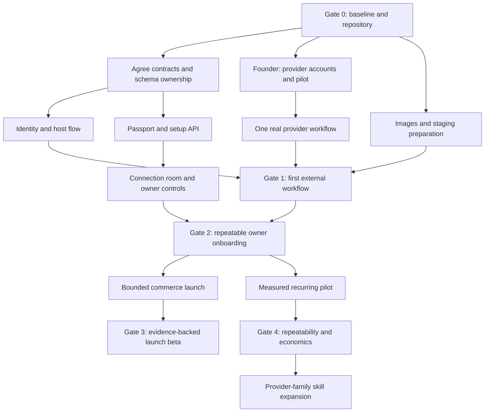

# Execution plan

## Optimization objective

Maximize verified customer value per engineering/support hour while preserving owner authority. Reuse implemented infrastructure, choose one measurable workflow, start long-lead provider prerequisites early, and parallelize only work with stable interfaces. The complete 31-skill vision remains a roadmap; activation is earned per provider, skill version and environment.

## Dependency map

Baseline host authorization can use the existing email/MFA flow; Google sign-in and passkeys must not block the first real-provider proof. Local UI/API development can continue while external accounts are pending. Production activation cannot.

## Milestones and exit criteria

| Gate | Outcome | Required evidence | Stop rule |
|---|---|---|---|
| G0 — Reproducible baseline | Same source builds/tests from a clean checkout | Commit, backend results, web checks, traceability, migrations, dependency/secret scan, first CI results | Resolve baseline failures before unrelated expansion; never hide failures with skips |
| G1 — First real workflow | One authorized input produces one verified provider result and survives interruption | Real provider account/environment; receipt/readback; duplicate/crash/revoke tests; hosted owner controls; one supported assistant session | If access is blocked, retain harness/read-only/shadow path and report blocker; no simulated proof substitution |
| G2 — Repeatable onboarding | Owner connects, resumes after redirect, understands grants and can stop work | New/returning user walkthrough, explicit org, profile reuse, mobile recovery, revoke/expiry behavior, setup metrics | Do not recruit broad self-service customers while every setup needs code edits |
| G3 — Commerce launch beta | One approved geography/niche/store path staged and independently verified | Provider facts for store, products, payment eligibility, test checkout, tax/shipping readiness, exact go-live approval; real completion evidence | Missing critical signal remains waiting/blocked; never auto-mark KYC or physical delivery |
| G4 — Measured repeatability | Repeated successful use with sustainable support and costs | Pilot observation window, verified operations, cost reconciliation, corrections, retention/payment evidence and restore drill | Fix reliability/cost problems before adding verticals or scaling field sales |
| G5 — Controlled expansion | Additional workflows reuse proven connectors | Per-skill action graph, expert cases, model evals, provider evidence and rollback | Contract parsing or generic preparation never promotes a skill to live |

## Work packages

November 9 update: EX-00 security remediation was merged into main after passing CI; the local isolated Compose smoke is recorded in the [verification ledger](06_VERIFICATION_AND_RELEASE.md). EX-01's isolated Gmail harness was prepared in PR #2 with provider-double and CI evidence; consult that PR for its integration status. A real Gmail proof, hosted deployment and the remaining release-gate scenarios are not established by these results.

Effort ranges below are planning estimates in focused engineer-days, not completion promises. They assume a developer familiar with the code and exclude provider review, owner decisions and cloud provisioning wait. Re-estimate after G0 and the first provider run. A solo founder should execute the same dependencies sequentially.

| ID | Deliverable | Dependencies | Owner | Estimate | Acceptance |
|---|---|---|---|---|---|
| EX-00 | Baseline ledger, repo publication, CI/toolchain reconciliation | None | A | 1–3 | Commit and checks reproducible; private source excluded; no unsupported green claims |
| EX-01 | Provider proof harness and evidence format | EX-00 | D+G | 1–2 | Separate credentials/environment, safe fixture, receipt/readback capture, no writes without explicit test grant |
| EX-02 | One real Gmail connection + intake/send proof | EX-01 + owner access | D | 2–4 | Correct account/scopes, refresh/revoke, intake, exact authorized test send, independent Sent readback |
| EX-03 | Real authoritative order sink | EX-01 + selected pilot system | D | 2–5 | External draft/order ID read back; duplicate events and lost responses do not blindly repeat writes |
| EX-04 | Real assistant OAuth/MCP acceptance | EX-00 + reachable authorized HTTPS | B | 1–3 | Start/read/pause same org task; refresh/revoke; unsupported surface accurately labeled |
| EX-05 | Typed Passport + setup contracts/migration | EX-00 | C with A schema owner | 2–4 | Versioned fields/provenance, export/deletion, setup survives redirects and tenant mismatch denied |
| EX-06 | Google sign-in and explicit account linking | EX-00 + identity client config | B | 3–5 | Correct issuer/subject, nonce/state/audience validation, replay denial, safe linking/recovery; no implicit Gmail grant |
| EX-07 | Connection room and missing-question intake | EX-05; EX-06 optional | E | 3–5 | Real API states, profile reuse, clear provider handoff, interrupted mobile flow and pending actions |
| EX-08 | Evidence-derived launch readiness projection | EX-00 + contract agreement | F | 2–4 | Same result on REST/MCP/web; stale/revoked/test evidence cannot assert production readiness |
| EX-09 | Build images and stage deployment/restore | EX-00 + Docker; deployment approval | A | 2–5 | API/web/worker run, migrations/roles, callbacks, alerts, restore, worker recovery; image digests recorded |
| EX-10 | Initial model evaluation and cost benchmark | EX-01 + owner-approved key/budget | G | 2–4 | Held-out domain cases, failing model rejected, measured cost/latency/quality and attempt caps |
| EX-11 | Bounded commerce launch graph | G1 + EX-05/07/08 + Shopify access | F+D | 5–10 | Draft and publication receipts, owner handoffs, actual test checkout and readiness gates |
| EX-12 | Shipping/fulfillment evidence integration | EX-11 + selected carrier/system | F+D | 3–7 | Authoritative dispatch receipt; tracking reconciliation; record creation distinct from shipment/delivery |
| EX-13 | Second assistant continuity proof | EX-04 + G2 | B+G | 1–2 | Same account/org/task, independent client revocation and role downgrade enforcement |
| EX-14 | Recurring pilot and second-workflow measurement | G1/G2 + founder/pilot agreement | G+founder | 2–4 setup; 2–4 weeks observation | Real denominators, support minutes, corrections, cost/receipts and actual payment status |
| EX-15 | First additional skill promoted | G4 + chosen business system/expert | D+G | 3–8 per bounded skill | Skill-specific graph, expert cases, negatives, provider sandbox, rollout/rollback |

Gmail send proof can be useful before order-sink integration; call that a connector proof, not a completed order workflow. Likewise an ERP sandbox result is not a production customer deployment.

## Suggested staffing sequence

**Wave 0:** A establishes baseline/repository/toolchain and reserves shared changes. D prepares one-provider harness. G reviews evidence gaps and acceptance cases. Founder chooses one actual workflow and starts provider prerequisites.

**Wave 1:** B proves current host authorization and designs Google linking; C builds typed profile/setup API; D performs provider proof. A integrates and owns migrations. E's UI implementation starts after C's contract lands, replacing a lane rather than adding unrestricted concurrency.

**Wave 2:** E delivers the owner journey; D closes the real order loop; A verifies images/staging; G runs release acceptance and measures corrections. F can prepare readiness contracts, but avoid editing shared launch paths concurrently with D.

**Wave 3:** F integrates commerce readiness/stages using proven services; B verifies the second assistant; G measures pilots and model/economic quality. Add carrier work only when the chosen beta requires it and a supported system is selected.

**Wave 4:** Choose the next skill by actual demand and reusable provider access. Expand only after G4. Keep regulated or unsupported-provider skills draft-only.

An indicative horizon is 1–2 weeks for baseline/first-provider evidence, another 1–2 weeks for repeatable onboarding, and 2–4 further weeks for a narrow launch beta and pilot observation. These periods overlap only where dependencies permit, exclude external approval waits, and must be revised from observed velocity. They are not a promise that the full catalog ships in that time.

## Skill expansion map

All rows except the order anchor currently remain draft/review only. This grouping is a proposed delivery order, not a status change. Within a group, the founder-selected customer/system wins over this default order.

| Wave | Skills | Shared dependency and release boundary |
|---|---|---|
| Anchor | `multichannel_order_entry` | Real inbound channel plus actual system of record; verified draft/order readback |
| Commerce adjacency | `shopping_guidance`, `restaurant_inventory_planning`, `outbound_shipping_management`, `ecommerce_returns`, `abandoned_cart_retention` | Catalog/inventory/shipping adapters; pricing freshness, consent, return/refund authority; do not enable refunds with only message permission |
| Existing pilot channels/services | `restaurant_voice_ordering`, `home_service_dispatch`, `field_service_opportunity_detection`, `crm_reactivation_and_hygiene` | Real telephony/POS/CRM/dispatch systems, customer consent, human escalation, jurisdiction and safety constraints |
| General administration | `workflow_discovery`, `custom_legacy_workflow`, `field_inspection_reports`, `property_maintenance`, `construction_estimates`, `hardware_procurement`, `freight_order_to_cash` | Defined source systems, documents, quote/dispatch/PO APIs, reviewable outputs; purchases and binding submissions separately approved |
| Marketing | `website_organic_growth`, `lead_research_and_outreach`, `paid_ad_campaign_operations`, `social_media_operations`, `local_creator_campaigns` | Authorized CMS/ad/social/CRM accounts; contact eligibility, exact publication/spend bounds and attribution |
| Professional/regulated administration | `bookkeeping_reconciliation`, `accounting_practice_operations`, `tax_return_preparation`, `legal_matter_intake`, `commercial_insurance_submission`, `candidate_screening`, `dental_reception_and_claims`, `property_valuation_reports`, `title_closing_support` | Qualified reviewer, approved jurisdiction/data access/system, domain gold cases and mandatory human responsibility; no autonomous certification or consequential decisions |

`commerce_business_launch` is the cross-skill playbook, not a 32nd fully implemented domain skill.

## Issue and PR execution format

Create GitHub issues only when the owner requests backlog publication; the IDs here work without external issue creation. Every implementation PR should identify one EX package, base commit, problem/result, affected contracts/migration, scope, tests, environment, source links for provider changes, rollback and unresolved blockers. No unrelated upgrades or refactors.

The integrator accepts a package only when the code, tests, evidence and status documents agree. A missing credential can block live verification while local code is complete; report these as two separate states. A handoff never says simply “done” when a required gate is pending.
